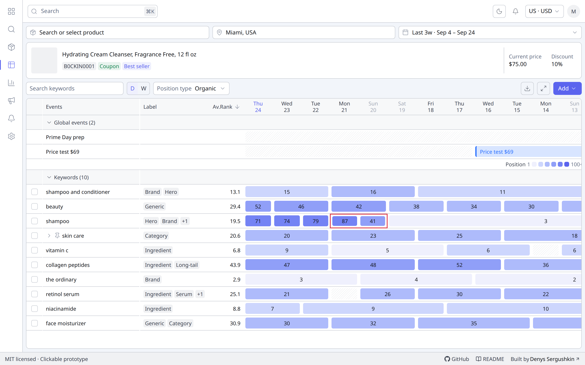
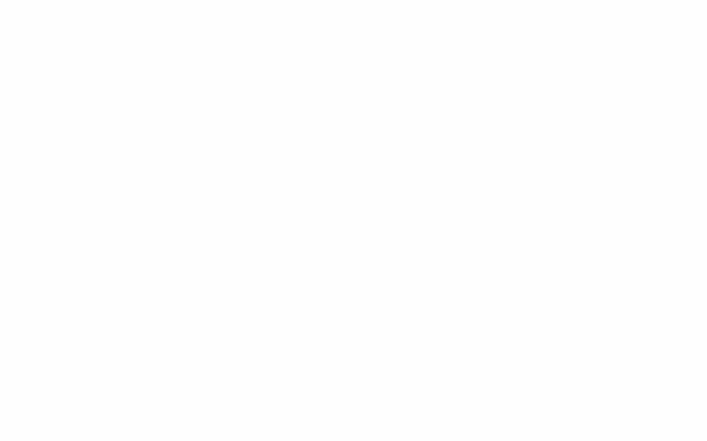

# Keyword Tracker

A clickable front-end prototype of a keyword rank tracker. The table is the chart: days that share a rank join into one cell.

[Try it →](https://keyword-tracker-nine.vercel.app)

**Status:** all data is mocked in TypeScript. There is no backend.

[](https://keyword-tracker-nine.vercel.app)

[](https://keyword-tracker-nine.vercel.app)

The still is the default three weeks. The GIF changes that window.

A product summary and a table of events and keywords for 4–24 September 2026.
Consecutive days with the same rank join into one cell, so a long flat run reads
as stability and a row of narrow cells reads as volatility. Rank is drawn on a
single-hue ramp from light to dark, because rank is an ordered quantity.

## What it is

The page shows one product, **Hydrating Cream Cleanser, Fragrance Free, 12 fl oz**,
with the chips `B0CKIN0001`, Coupon, and Best seller, a current price of $75.00,
and a 10% discount. The filters read Miami, USA and Last 3w · Sep 4 – Sep 24.
The date field can switch that window to the last 7 days or the last 2 weeks.

Under that, the table's accessible name is "Keyword ranks and events,
4 September 2026 to 24 September 2026". The columns are select, Events, Label,
Av.Rank, and one column per day. The newest day is on the left. 24 September
is marked today in the column header. Weekend headers use
`text-fg-quaternary`. The first four columns stay fixed while the days scroll.

The seed is ten keywords in `src/data/keywords.ts` and two events in
`src/data/events.ts`: Prime Day prep (5–11 September) and Price test $69
(9–16 September). A keyword shows its first two labels, then a `+N` chip when
there are more. Average rank is the mean of the days in the current window
that have a rank, to one decimal, or an em dash when every day is empty.

The Position legend runs from 1 to 100+. Hovering it opens a popup titled
"Definition: Amazon position", with ticks at 1, 5, 15, 40, 70, and 100+. The
two paragraphs under that title are placeholder text. The timeframe line reads
"Timeframe: 1 week".

Design case study: [Dribbble — Keyword Tracker](https://dribbble.com/shots/27680234-Design-Case-Study-4-Keyword-Tracker).

## How the cells work

`toRuns` in `src/lib/runs.ts` joins consecutive equal values into one cell.
`displayOrder` reverses the series first, so a run is consecutive days on
screen, newest at the left. The same rank with a different value between the
two days stays two cells. Consecutive days with no rank merge with each other
and stay separate from a numbered rank. A missing rank is drawn with a hatch.

`src/lib/rankColor.ts` maps a rank onto six steps. `RAMP` is `'sequential'`.

| Rank | Step |
| ---- | ---- |
| 1–5 | 1 |
| 6–15 | 2 |
| 16–40 | 3 |
| 41–70 | 4 |
| 71–100 | 5 |
| 100+ | 6 |

Each step mixes `--bg-brand-tertiary` toward `--bg-brand-primary`: step 1 is
the tertiary color, then 20%, 40%, 60%, and 80% of the primary, and step 6 is
the primary. A traffic-light ramp is in the same file behind that constant:
set `RAMP` to `'trafficLight'` to compare it. The legend uses whichever ramp
the constant selects.

A merged rank cell's accessible name is the rank, the dates, and the length
when the run is longer than a day, for example "Rank 3, 12–15 September, 4
days". A missing rank reads "No rank" plus the dates. An event bar reads the event
name and the span. Hovering the bar shows the name and the date range, and the
label is drawn on the bar when the span is wide enough to fit it.

## Using it

Theme starts light. The top-bar button switches between light and dark for
this visit.

| Control | What it does |
| ------- | ------------ |
| Date field | Switches the window: Last 7d, Last 2w, or Last 3w. The day columns, merged runs, averages, and event bars follow that window. |
| Keyword checkbox | Selects that row. A bar then shows the count, Select all, and Deselect all. |
| Global events / Keywords | Collapses that group. Both start open. |
| `skin care` | The only keyword with sub-rows. Expanding it shows PPC Sales, Brand Analytics, SQP Market share (with a % suffix), and an Amazon's Choice bar from 10–17 September. |
| Add → New event, or `E` | Opens the New event drawer. `E` does nothing while focus is in a field. |
| Day headers, while the drawer is open | Drag to set the date range. The drawer shows the range, or "Select on the timeline" before that. |
| Create | Needs a name and a range. An empty label uses the name. Colors are purple, azure, amber, teal, and rose. The new event is added at the top of the list. |
| Escape | Closes the drawer and clears the highlighted days. |

A new event, the time window, and the theme live in memory for this visit.
Reloading brings back the two seeded events, the three-week window, and the
light theme. Nothing is stored, and there is no server.

## On screen only

These are visible and do not change the keywords, the ranks, or the events:

- The top-bar Search field, including the ⌘K chip painted on it, and Search keywords
- The product and location fields
- Position type, which only updates its own label (Organic, Sponsored, or Side-by-side)
- The D / W marks. D is shown highlighted. Neither letter is a button.
- Export and Fullscreen
- Add → New keyword, which only closes the menu
- The icon rail, the bell, US · USD, and the avatar
- Create list, Add to favourites, and Delete on the selection bar

## Running it

```bash
npm install
npm run dev
```

```bash
npm run typecheck
npm test
npm run lint
npm run build
```

`npm test` runs the unit tests in `src/lib/*.test.ts` (merged runs and the six
rank bands). `npm run lint` runs oxlint. CI installs with `npm ci` on Node 22,
then runs typecheck, lint, test, and the production build.

## Built with


## License

MIT licensed. Copyright (c) 2026 sergushkin.com. See [LICENSE](./LICENSE).

The footer of the app reads "MIT licensed · Clickable prototype" and credits
[Denys Sergushkin](https://sergushkin.com).

## Live demo

Try it at [keyword-tracker-nine.vercel.app](https://keyword-tracker-nine.vercel.app).
